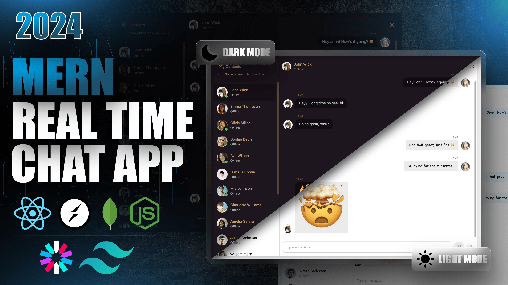

# Chatty 💬

A full-stack realtime chat application built with the MERN stack, Socket.io, and modern UI tools.



## Features

- 🔐 Authentication & Authorization with JWT
- 💬 Real-time messaging with Socket.io
- 🟢 Online user status tracking
- 🖼️ Image sharing via Cloudinary
- 🎨 Beautiful UI with TailwindCSS + DaisyUI (30+ themes)
- 📦 Global state management with Zustand
- 🛡️ Robust error handling (server & client)

## Tech Stack

**Frontend:** React, Vite, TailwindCSS, DaisyUI, Zustand, Socket.io-client  
**Backend:** Node.js, Express, MongoDB, Mongoose, Socket.io, JWT, Cloudinary

## Setup

### Environment Variables

Create a `.env` file in the `backend` directory:

```env
MONGODB_URI=...
PORT=5001
JWT_SECRET=...

CLOUDINARY_CLOUD_NAME=...
CLOUDINARY_API_KEY=...
CLOUDINARY_API_SECRET=...

NODE_ENV=development
```

### Install & Run

```bash
# Install all dependencies (backend + frontend)
npm run build

# Start the app
npm start
```

The app runs on `http://localhost:5001` by default.
